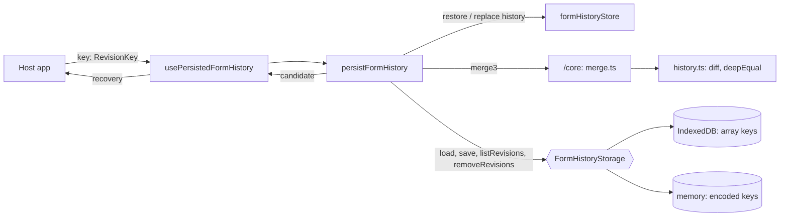
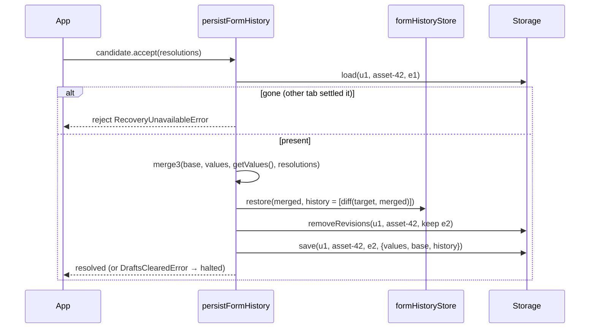

# Plan: Draft recovery onto a newer revision

> **Spec:** [spec.md](./spec.md)
> **Status:** Approved
> **Last updated:** 2026-11-20

## Architecture



- **`/core`:** a new pure `merge.ts` (three-way merge on top of `diff`/`deepEqual`, no react-hook-form dependency).
- **`persistence/`:**
  - The storage contract gets structured keys plus two document-level operations.
  - `persistFormHistory` captures base values and detects a recovery candidate after the exact-draft lookup.
  - It also exposes `preview`/`accept`/`discard`.
- **Existing pieces reused:**
  - `formHistoryStore.restore` already replaces values and history in one call, without recording a step.
  - `isPersistedRecord` is extended with `base`.
- **Package not yet published.** The storage interface change is not a breaking release; it lands under the pending `initial-release` changeset plus a minor changeset.

## Interfaces / contracts

### Keys (`persistence/storage.ts`)

```ts
/** A draft of one revision of one server document, per user scope. */
export type RevisionKey = { scope: string; document: string; revision: string };
/** Plain string keys behave exactly as before (no base values, no recovery). */
export type DraftKey = string | RevisionKey;
```

### Storage contract (`persistence/storage.ts`)

```ts
export type FormHistoryStorage = {
  load: (key: DraftKey) => Promise<PersistedFormHistory | undefined>;
  save: (key: DraftKey, record: PersistedFormHistory) => Promise<void>;
  remove: (key: DraftKey) => Promise<void>;
  clearAll: () => Promise<void>;
  removeOlderThan: (timestamp: number) => Promise<number>;
  /** Revisions stored for (scope, document), any order. Never includes other documents or scopes. */
  listRevisions: (
    scope: string,
    document: string,
  ) => Promise<Array<{ revision: string; savedAt: number }>>;
  /** Deletes every revision of (scope, document) except `keep`, if given. */
  removeRevisions: (scope: string, document: string, keep?: string) => Promise<void>;
};
```

- **Call order.** All operations, including the two new ones, keep the call-order guarantee.
- **IndexedDB** (`indexedDbStorage.ts`):
  - **Key encoding.** A `RevisionKey` is stored as the array key `[scope, document, revision]`, and string keys stay strings. Both coexist in the existing object store: IndexedDB orders strings before arrays, so the two can't collide.
  - **Range.** `listRevisions` and `removeRevisions` use `IDBKeyRange.bound([scope, document], [scope, document, []])`. The upper bound `[]` sorts after every string revision.
  - **Which operations.** `listRevisions` iterates a cursor over that range and returns `{ revision: key[2], savedAt: value.savedAt }`. `removeRevisions` calls `store.delete(range)` (or two open ranges around `keep`) in one readwrite transaction.
  - **No upgrade needed.** There is no schema change, so `DB_VERSION` stays at 3.
- **Memory** (`createMemoryStorage`): the map key is `JSON.stringify(key)` (a JSON string for string keys, a JSON object for revision keys), so the two can't collide. Listing filters on the parsed scope and document.
- **`nullStorage`:** `listRevisions` → `[]`, `removeRevisions` → no-op.

### Record (`persistence/storage.ts`)

```ts
export type PersistedFormHistory = {
  version: number;
  savedAt: number;
  values: FieldValues;
  history: History;
  /** Values of the draft's revision when editing started. Present only for RevisionKey drafts. */
  base?: FieldValues;
};
```

- **Structural check.** `isPersistedRecord` additionally requires that `base`, when present, is a non-null non-array object.

### Three-way merge (`src/merge.ts`, exported from `/core`)

```ts
export type Conflict = { path: string; base: unknown; mine: unknown; theirs: unknown };
/** Per conflict path; unresolved conflicts keep `theirs` (AC-14). */
export type Resolutions = Record<string, 'mine' | 'theirs'>;
export type MergeResult<T = unknown> = {
  merged: T;
  /** Own changes written onto `theirs`, as patches from theirs → merged. */
  applied: Patch[];
  conflicts: Conflict[];
};
export function merge3<T>(base: T, mine: T, theirs: T, resolutions?: Resolutions): MergeResult<T>;
```

**Algorithm:**

1. **Find changes on both sides.** `mineChanges = diff(base, mine)` and `theirChanges = diff(base, theirs)`. `diff` already turns a length-changed array into one whole-array patch (AC-13).
2. **Group overlapping changes.** For each mine change at `p`, find the their changes at `q` where `p === q` or one path is a prefix of the other (on `.` boundaries). If there are none, the change applies cleanly.
3. **Pick the conflict path.** Overlapping changes form a group, and its conflict path is the **outermost** path in the group. A conflict whose value is the whole array or object makes "keep mine" well defined.
4. **Skip identical results.** If `deepEqual(get(mine, P), get(theirs, P))`, there is no conflict and nothing to apply (AC-12).
5. **Otherwise report a conflict** `{ path: P, base, mine, theirs }`, each read at `P`. If `resolutions[P] === 'mine'`, write mine's value at `P` (AC-15).
6. **Build the merge.** `merged` starts as `structuredClone(theirs)`. Clean changes and "mine" resolutions are written in `mineChanges` order. `applied` lists `{ path, before: theirs@path, after: mine@path }`.

- **Path helpers.** `getPath`/`setPath` are internal helpers in `merge.ts` for `diff`'s dot paths. They refuse `__proto__`, `constructor` and `prototype` segments.
- **Purity.** `merge3` never mutates its inputs.

### Persistence (`persistence/persistFormHistory.ts`)

```ts
export type PersistOptions = {
  // unchanged options ...
  key: DraftKey;
};

export type RecoveryPreview = MergeResult<FieldValues> & {
  /** `validate(merged)`; true when no validate option was given (AC-16). */
  valid: boolean;
};

export type RecoveryCandidate = {
  revision: string;
  savedAt: number;
  /** Merges against the form's current values (target). Pure; no form, history or storage change (AC-9). */
  preview: (resolutions?: Resolutions) => RecoveryPreview;
  /** Applies the merge, replaces history with one entry, saves (D, R), deletes stale revisions (AC-17–19). */
  accept: (resolutions?: Resolutions) => Promise<void>;
  /** Deletes stale revisions; the form is untouched (AC-20). */
  discard: () => Promise<void>;
};

export type FormHistoryPersistence = {
  restored: Promise<boolean>;
  /** Resolves after the restore attempt: a candidate for RevisionKey forms, else null. */
  candidate: Promise<RecoveryCandidate | null>;
  flush: () => Promise<void>;
  clear: () => Promise<void>; // RevisionKey: removeRevisions(scope, document) (AC-22)
  dispose: () => void;
};

/** `accept` rejects with this when the stale draft is gone (accepted or discarded in another tab). */
export class RecoveryUnavailableError extends Error {}
```

- **Base values.**
  - Captured as `structuredClone(form.getValues())` synchronously in `persistFormHistory`, before the restore. If an exact draft is restored, `base` is taken from that record.
  - Every save of a `RevisionKey` draft writes the same `base` (AC-7). String-key drafts never get `base` (AC-8).
- **Candidate detection** (inside the existing restore attempt, after the exact lookup misses):
  1. Call `listRevisions(scope, document)`, drop the current revision, and sort by `savedAt` descending.
  2. For each revision, `load` it. If it fails `isPersistedRecord`, has no `base`, is on another `version` or is expired, `remove` it and try the next one (AC-5).
  3. The first usable revision becomes the candidate (AC-3). Detection ignores `canUndo` on the store, unlike exact restore (AC-6).
  4. Storage errors go to `onError`, and the candidate is `null`. The exact restore has already finished at this point.
- **`accept(resolutions)`:**
  1. Re-`load` the candidate key. If it's missing, reject with `RecoveryUnavailableError`.
  2. Run `merge3(record.base, record.values, form.getValues(), resolutions)`.
  3. Call `store.restore({ values: merged, history })`, where `history` is `createHistory()` plus one entry `{ patches: diff(target, merged) }`. When there is no patch, the form and its history are left untouched and only the stale revisions are deleted (spec edge case; changed during implementation).
  4. Issue `removeRevisions(scope, document, revision)`, then `save(key, record)` synchronously in that order. A `DraftsClearedError` from the save halts persistence and is re-thrown (AC-23).
- **`discard()`:** `removeRevisions(scope, document, currentRevision)`.
- **Already settled.** After `accept` or `discard` resolves, calling either again rejects with `RecoveryUnavailableError`.

### React hook (`persistence/usePersistedFormHistory.ts`)

```ts
export function usePersistedFormHistory<T extends FieldValues>(
  form: UseFormReturn<T>,
  history: FormHistoryStore,
  options: PersistOptions,
): { status: PersistStatus; clear: () => Promise<void>; recovery: RecoveryCandidate | null };
```

- **Effect deps.** The effect depends on a stable key id (the string itself, or `JSON.stringify([scope, document, revision])`), not on the key object's identity.
- **Clearing the candidate.** `recovery` is set once when `candidate` resolves, and reset to `null` after `accept` or `discard` settles.

### Example app (`examples/react-vite`)

- **Fake server.** `src/form/fakeServer.ts` holds the profile values plus a `revision` (incrementing `r1`, `r2`, …) in `sessionStorage`. `simulateRevision()` changes one field (e.g. appends to `bio`) and bumps the revision (AC-25).
- **Profile form.** `ProfileForm` receives `{ values, revision }` from the fake server, uses them as `defaultValues`, and passes `key: { scope: 'demo-user', document: 'profile', revision }`. `App.tsx` remounts it with `key={revision}`.
- **Recovery dialog.** `src/components/RecoveryDialog.tsx` is a leaf component (shadcn dialog) that receives `recovery`. It lists `preview().applied` and `preview().conflicts`, keeps the resolutions in local state, and calls `accept(resolutions)` or `discard()` (AC-26). It sits next to `HistoryToolbar`, so the form itself doesn't re-render.
- **Saving.** Submit "saves to the server": it writes the values, bumps the revision and calls `clear()` (AC-22).
- **Draft versions.** Bump `DRAFT_VERSION`, because the demo's draft key changes. Old string-key drafts are left to expire.

### Exports

- **`src/index.ts`:** `RevisionKey`, `DraftKey`, `RecoveryCandidate`, `RecoveryPreview`, `RecoveryUnavailableError`, and re-exports of `Conflict`, `Resolutions`, `MergeResult`.
- **`src/core.ts`:** also `export * from './merge'`.

## Data model

| Change                       | Detail                                                                                                                                                                |
| ---------------------------- | --------------------------------------------------------------------------------------------------------------------------------------------------------------------- |
| `PersistedFormHistory.base?` | New optional field; absent on string-key drafts and on drafts from before this feature.                                                                               |
| IndexedDB keys               | Array keys `[scope, document, revision]` next to existing string keys in the same store. No new store or index, and `DB_VERSION` stays 3.                             |
| Migration                    | None. Older `RevisionKey` drafts can't exist, because the feature is new.                                                                                             |
| Size                         | A `RevisionKey` record holds `values` + `base` + patches, roughly 2× values. Accepted for v1; a benchmark task measures the save cost at 30k fields (see Trade-offs). |

## Sequence diagrams

### Opening a newer revision with a stale draft

```mermaid
sequenceDiagram
    participant App
    participant P as persistFormHistory
    participant S as Storage
    App->>P: start(key {u1, asset-42, e2})
    P->>P: base = clone(getValues())
    P->>S: load(u1, asset-42, e2)
    S-->>P: undefined
    P->>S: listRevisions(u1, asset-42)
    S-->>P: [{e1, t1}]
    P->>S: load(u1, asset-42, e1)
    S-->>P: record (base, values, history)
    P->>P: checks (structure, base, version, expiry)
    P-->>App: restored=false, candidate={e1, preview, accept, discard}
    Note over P: ready = true; edits now save under e2 with base
```

### Accepting a recovery



## Trade-offs considered

- **Storing the full `base` per draft** (accepted). It is the simplest correct choice, and its cost is about 2× record size and clone time per save. The alternative of storing `diff(values, base)` keeps records small, but costs a whole-form diff on every save, which is the same order of cost as the clone it saves. Revisit if the benchmark shows a save over 10 ms at 30k fields.
  - **Measured (2026-11-20)**, local dev Mac, `persistFormHistory.bench.ts` (memory storage, whose `structuredClone` stands in for IndexedDB's), mean ms per edit + `flush()` minus the edit-only baseline (0.37 ms at 3k, 3.64 ms at 30k fields):

    | Fields | String key (no base) | RevisionKey (with base) |
    | ------ | -------------------- | ----------------------- |
    | 3k     | 0.32 ms              | 0.62 ms                 |
    | 30k    | 3.2 ms               | 6.4 ms                  |

    A save with a base costs about 2× one without, as predicted, and stays under the 10 ms threshold at 30k fields (the raw edit + save loop is 10.0 ms, but the edit is not part of the save). The decision stands. The margin is under 2×, so re-measure if records grow (e.g. a much larger history).
- **Rebuilding `base` by undoing all of `past`** (rejected). It breaks as soon as `limit` drops old entries.
- **String keys with a separator** (rejected, as decided in the spec). Array keys make the lookup exact and allow any characters in a revision.
- **A separate object store for revision drafts** (rejected). It would need a `DB_VERSION` bump and split `clearAll`/`removeOlderThan`/epoch handling across stores, while array keys fit the existing store.
- **Reporting conflicts at the innermost path** (rejected). "Keep mine" on one element inside an array that the server reshaped has no well-defined result, so the outermost overlapping path is used instead.
- **Keeping the user's pending edits as history when accepting** (rejected). The spec requires exactly one undo entry (AC-17), and old patches would also have the wrong `before` values.

## Steering check

There is no `specs/_steering/` yet; the rules come from `CLAUDE.md`.

- ✅ **Storage call order:**
  - `accept` issues `removeRevisions` and then `save` synchronously, with no `.then` chaining.
  - The new IndexedDB operations are single transactions.
  - The memory adapter applies them synchronously.
- ✅ **No write before the restore attempt:** `ready` is set only after candidate detection finishes.
- ✅ **No form-level re-renders:** the hook calls `setState` once when the candidate resolves, the same as `status` does today. `preview` doesn't render, and the host app shows the dialog in a leaf component.
- ✅ **Cross-tab clear epoch:** `accept`'s save goes through the guarded `save`, and the halt/re-throw path is reused.
- ✅ **Restored records are untrusted:** stale drafts go through the extended `isPersistedRecord`, and `merge3`'s path helpers refuse prototype segments.
- ✅ **Versions:** no IndexedDB schema change, so `DB_VERSION` stays 3. The demo's `DRAFT_VERSION` changes only if the demo form changes.
- ✅ **Public API:** the README API reference is updated, `check:pkg` passes, and a minor changeset is added.
- ✅ **Tests:** names follow `should X when Y`. New adapter operations go into the `storage.test.ts` `describe.each` contract suite.

## Open questions

None.

**Resolved (2026-11-20):**

- **Conflict path.** AC-11 now names the outermost overlapping path.
- **Demo.** The demo is part of this feature (AC-25, AC-26). See "Example app" under Interfaces.
